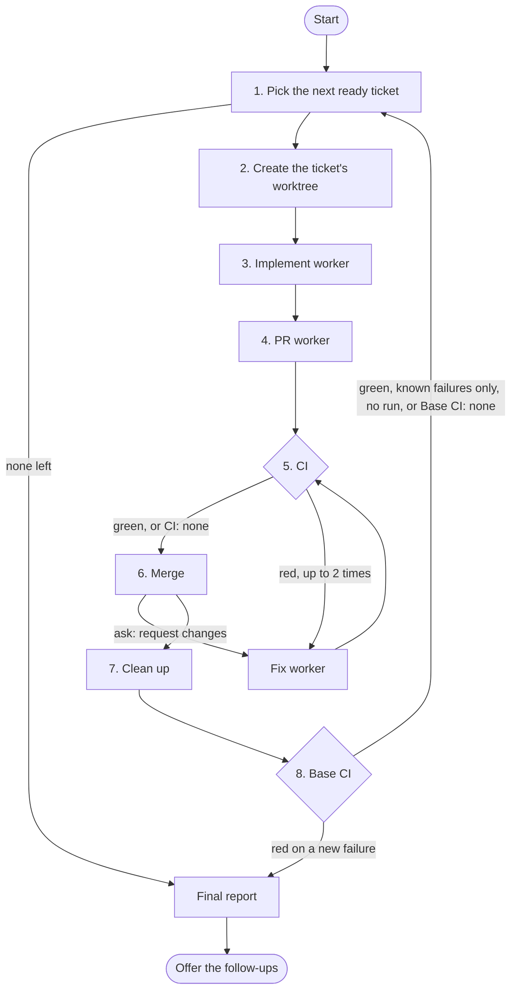

# How the loop works
{: .no_toc }

`/ship-tickets` runs the loop written for the agent in [`skills/ship-tickets/ship-tickets-loop.md`](https://github.com/samfaina/agent-skills/blob/main/skills/ship-tickets/ship-tickets-loop.md). This page explains it for people. When the two disagree, the loop file is what runs.

1. TOC
{:toc}

## Before the first ticket

The coordinator:

- finds `orca` on your `PATH` and loads Orca's orchestration guide, the source of truth for every worker command;
- reads `docs/agents/shipping.md` from the remote default branch and stops if it isn't there;
- turns your arguments, in your order, or every open `ready-for-agent` issue, lowest number first, into the **ticket set**;
- settles the **merge approval**: `ask` or `auto` from your arguments, otherwise the **Merge approval** field in `shipping.md`, otherwise `ask`;
- reads from the **Workers** field which harness each worker role starts in;
- says which version of the loop runs, and if a newer release exists, shows both versions and the update command and asks whether to go on or stop to update, even with Merge approval `auto` (see [An older version of the loop runs](troubleshooting#an-older-version-of-the-loop-runs)). If it can't read the version, it says so and goes on;
- checks that the implement worker's harness will load the `tdd` and `code-review` from mattpocock/skills, and stops if it would load another skill with the same name (see [the provenance check](harnesses#the-skill-provenance-check));
- checks the base branch's **Base CI**, the CI runs that pushes to it start, waiting for them if they are still running. Green, or no runs, it says so in one line. Red, it shows the failed jobs and asks whether to go on or stop, even with Merge approval `auto`, since every ticket would build on a red base (see [The base branch is red before the first ticket](troubleshooting#the-base-branch-is-red-before-the-first-ticket)). With `Base CI: none`, it skips the check;
- opens one Orca run for the whole session, which every worker belongs to.

## 1. Pick

A ticket is **ready** when it is open and none of its blockers is: GitHub reports no open blocking issues, and every issue in a `Blocked by:` line of its body is closed. The coordinator takes the first ready ticket in the order you gave the issue numbers, or the lowest-numbered ready ticket when you gave none. A ticket with an open blocker waits until its blockers close, then takes its place in your order again: with `6 2 3 1` and #6 blocked by #1, the run ships #2, #3, #1, #6.

If tickets are left but none is ready, the loop stops and tells you which open blockers hold them.

## 2. Worktree

The coordinator fetches and creates an Orca worktree for the issue, branched from the base branch on the remote. The branch name follows the naming rule in `shipping.md`.

Because tickets ship one at a time, each worktree starts from a base that already has the previous ticket merged.

## 3. Implement

A fresh agent gets the implement spec, in the harness **Workers** names for the implement role. It reads the issue and anything it links, builds test-first with the `tdd` skill, runs the full test suite, reviews its own diff against the issue with `code-review`, fixes what that finds, and commits. It doesn't push. Its report names the folder it loaded each of the two skills from. If it can't load one of them, it fails and names the missing skill.

If the worker has a question, it asks the coordinator. The coordinator answers from the ticket and the repo when it can, and otherwise asks you and passes your answer on. The coordinator handles the PR and fix workers' questions the same way.

The implement and fix workers change files with their file-editing tool, never with shell scripts, heredocs or redirections: no one is at a worker's terminal, so a permission prompt that such a command raises waits and then refuses. If any worker still stops at a prompt and escalates that it needs input, the coordinator tells it to redo a file change with its file-editing tool rather than retry the command, and keeps waiting. That doesn't stop the loop or count as a fix round.

The coordinator accepts the work only when the branch has new commits, the working tree is clean, and both skills came from the folders the check before the first ticket found.

## 4. PR

A second fresh agent, in the same worktree, pushes the branch and opens the PR with the title and body format from `shipping.md`, working from the commits, the diff and the issue. The body ends with `Closes #<n>`.

The coordinator checks the PR is on the ticket's branch and that `Closes #<n>` is in its body.

## 5. CI

The coordinator waits until GitHub lists checks for the PR, which can take a few minutes after a push, and then until they finish. If no check starts within 10 minutes, the loop stops.

How it waits depends on its harness. Where the harness notifies it when a background command exits, as Claude Code does, it waits in the background. Otherwise it waits in the foreground and starts the wait again when it times out. [Harnesses](harnesses#waiting-on-ci) covers each one.

- **Green:** go to the merge.
- **Red:** a fix worker reads the failing logs, reproduces the failure locally, fixes it and pushes, then CI runs again. A ticket gets at most two fix workers for CI. The third red run stops the loop.

With `CI: none` in `shipping.md`, this step is skipped.

## 6. Merge

The coordinator merges with the merge method from `shipping.md`. The merge approval it settled before the first ticket decides whether you approve first:

| Merge approval | What happens |
| --- | --- |
| `ask` (default) | Shows you the PR link, title and size, and asks: **Merge**, **Request changes** or **Stop**. Requested changes go to a fix worker, then back through CI and this question. Review rounds have no limit. |
| `auto` | Merges right away. If the harness refuses the merge, as Claude Code's auto mode does without the [merge hook](shipping-md#the-merge-hook-for-claude-codes-auto-mode), it asks you as with `ask`. |

The coordinator asks with its harness's question tool where it has one, and in plain text otherwise. [Harnesses](harnesses#asking-you-a-question) shows what to expect in each.

After the merge, the coordinator checks the issue closed, and closes it with a comment pointing at the PR if it didn't.

## 7. Clean up

The coordinator runs the after-merge step from `shipping.md` (deleting the remote branch, for example), removes the worktree, and checks that no worker from the run is left behind. Then it waits for Base CI.

Each of these commands runs on its own, so the harness's permission check sees exactly what runs. If the harness refuses the after-merge step or the worktree removal, as Claude Code's auto mode can, the coordinator leaves it undone and carries on: the ticket is still shipped, and the final report gives you the command to run. If the branch deletion fails because GitHub already deleted the branch, the step counts as done. Any other error from the after-merge step goes in the final report with its output. To drop the step altogether, turn on GitHub's "Automatically delete head branches" setting. `/setup-ship-tickets` offers to on a first setup, and on a later one with Merge approval `auto`.

## 8. Base CI

A repo can run a wider set of jobs on a push to the base branch than on its PRs, such as a full OS matrix only on `main`. Then a PR whose checks are green can still turn the base branch red. So after the merge the coordinator waits for the push runs of the merge commit, with no time cap, the same way it waits on a PR's checks.

- **Green:** it picks the next ticket.
- **Red:** it stops the loop and reports the failed jobs and the run links. The PR stays merged and the ticket closed, and it posts no comment, reverts nothing and reopens nothing: you decide whether to fix the base branch or revert the merge. See [The loop stopped after a merge turned the base branch red](troubleshooting#the-loop-stopped-after-a-merge-turned-the-base-branch-red).
- **No run within 2 minutes:** it picks the next ticket, and the final report says so. The push may be filtered by `paths` or `paths-ignore`, or the repo runs no CI on push.

If you chose to go on with a red base before the first ticket, the jobs that were failing then are **known failures**: they don't stop the loop while they keep failing, and the final report names them. One that passes once stops being known, so if it fails again later, the loop stops. A ticket that breaks a known failure in a new way can't be told apart from it.

With `Base CI: none` in `shipping.md`, this step is skipped. It doesn't depend on **CI**: with `CI: none`, the loop still waits here.

## Follow-ups

Workers often find work outside their ticket that was already wrong on the base branch, such as a bug they saw in passing. The implement and fix workers list it in their reports as **follow-ups**, naming the files involved, and a fix worker asked for something outside the ticket, by CI or by your requested changes, reports it as a follow-up instead of doing it. A review finding about code the ticket's own diff introduced isn't a follow-up: the worker fixes it in the ticket. Trouble with the loop itself isn't a follow-up either: it goes in the final report.

Before it releases the implement worker, the coordinator compares each follow-up's files with the files the branch changed. A follow-up that names a changed file, or no file, goes back to the worker, which fixes it in the ticket or says why it was already wrong on the base branch. The coordinator keeps only the ones the worker showed were already there, and the final report says what happened to each follow-up it sent back. If the worker fails or is gone instead of answering, the loop stops. The fix worker's follow-ups skip this check, since the out-of-scope work you or CI ask for often names a file the branch changed.

After the final report, whether the run finished or stopped, the coordinator merges the follow-ups that are the same and shows them as a numbered list. It marks the open issues each one may duplicate, and the issues in the same code: those whose body names a file the follow-up names, open or closed in the last 14 days, and the ticket it came from when its branch changed that file. When the same code has two or more issues, the entry says so, since one issue about that code's contract may serve better than another symptom. For each follow-up you pick: open it as a new issue, fold it into an open issue in the same code, or skip it. **All** opens every one as a new issue. It opens and folds nothing without your answer, even with Merge approval `auto`, and in a run with no one to answer it only lists them, marks included. Each issue it opens says what the worker saw and where, leaves the fix and its scope to your triage, ends with `Found while shipping #<n> (PR #<pr>)`, and gets the `needs-triage` label if your repo has it, never `ready-for-agent`. A follow-up you fold becomes one comment on that issue, written the same way, and its body and labels stay as they were. It gives you the link of each issue and comment.

## Workers and specs

Each worker starts in the harness that the **Workers** field in `shipping.md` names for its role: implement, PR or fix. One harness can run every role, or each role can have its own. A file without the field runs them all in Claude Code. See [Workers](harnesses#workers).

Every worker gets a written spec with the same five parts: **Target**, **Change**, **Constraints**, **Ownership** and **Observable acceptance**. The last one is the check the coordinator runs before accepting the work. A worker reporting success isn't enough on its own.

The coordinator renames each worker's Orca tab after its task, such as `#46 implement`, `#46 PR` or `#46 fix`, in place of Orca's `worker-<task id>`.

Workers in the same worktree don't share context. Each one starts empty, reads the issue, the repo and its spec, and settles with a single result.
